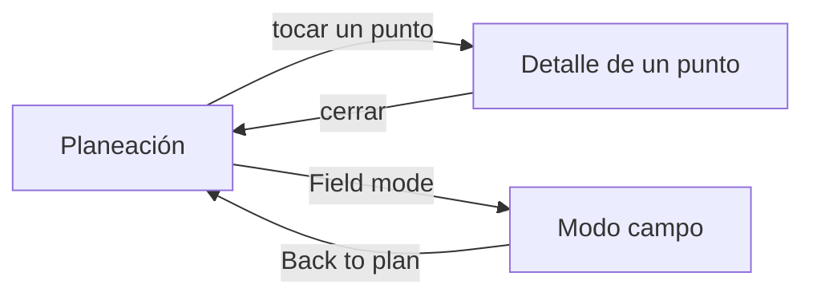

# 03 - Diseño de interfaces

**Estado:** listo (14 nov 2026)

Wireframes de baja fidelidad: grises y sin estilo final, porque aquí importa qué va en cada pantalla y dónde. Los textos de la interfaz están en inglés (RNF-06). Los valores que aparecen como `--` se llenan con datos reales; no se inventan en el diseño.

Los wireframes completos están en el lienzo de diseño del equipo. Se pueden exportar como imagen y guardar en esta carpeta (`planeacion.png`, `detalle-punto.png`, `modo-campo.png`).

## Pantalla 1: Planeación (laptop)

Cubre HU-01 a HU-09 y HU-11.

| Zona | Contenido |
| --- | --- |
| Barra superior | Nombre de la app, zona (Jezero Crater · Delta front), botones Open plan, Save plan y Field mode |
| Panel izquierdo: Layers | Cada capa con casilla, nombre, misión e instrumento, y control de opacidad: Base map, Slope, Minerals, Thermal inertia, Geologic units |
| Centro: mapa | Barra para agregar punto (Sample, Rest, Hazard) y zoom. El mapa muestra los puntos numerados, la ruta y las zonas de peligro |
| Panel derecho: Route | Pendiente máxima (empieza en 15°), lista de puntos en orden, botón Calculate route, distancia, desnivel, tiempo estimado y perfil de elevación |
| Panel derecho: Conditions | Hora de salida, temperatura, presión y radiación de referencia, con la fuente (MEDA, RAD) |

## Pantalla 2: Detalle de un punto (laptop)

Cubre HU-10. Se abre al tocar un punto en el mapa.

| Zona | Contenido |
| --- | --- |
| Mapa | El punto seleccionado resaltado y el radio de búsqueda de fotos |
| Panel lateral | Tipo y nombre del punto, coordenadas y elevación, botones Change type, Move y Delete |
| Fotos | Cuadrícula de fotos de Perseverance cercanas; la foto elegida muestra sol, cámara, fecha y crédito NASA/JPL-Caltech |
| Estado vacío | Si no hay fotos cerca, un mensaje lo dice en lugar de dejar el panel en blanco |

## Pantalla 3: Modo campo (tablet)

Cubre HU-12 y HU-13. Pensada para usarse con guantes: botones grandes y poca información a la vez.

| Zona | Contenido |
| --- | --- |
| Alerta (arriba) | Off route, con la distancia a la ruta. Siempre visible |
| Centro | Siguiente punto (2 of 3), flecha de rumbo, distancia y rumbo en letra grande |
| Lateral | Minimapa con lo recorrido, lo que falta y la posición simulada; tiempo transcurrido y distancia restante |
| Abajo | Tres botones grandes: Previous point, Mark sample taken, Back to plan |

## Flujo entre pantallas

