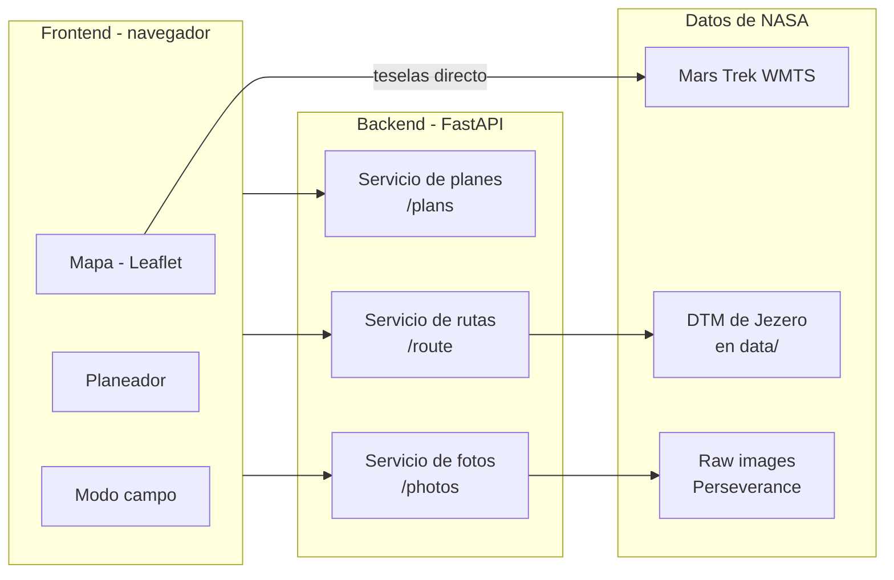
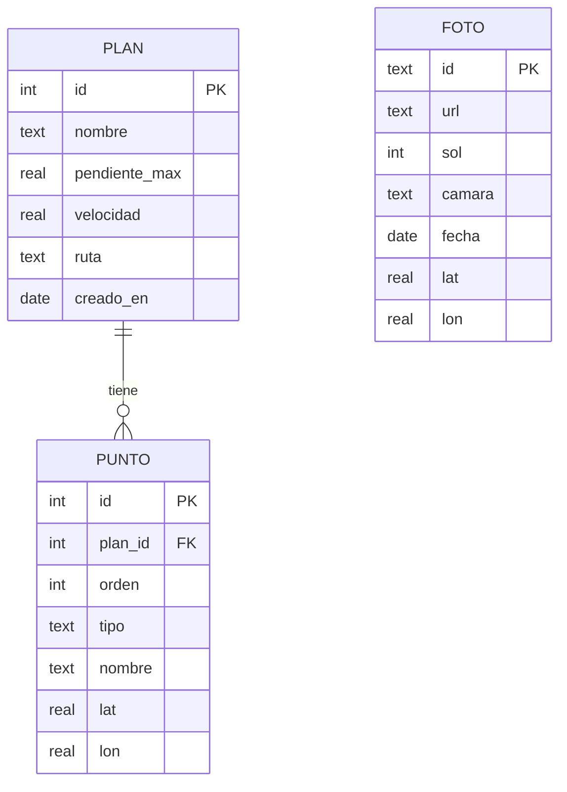

# 04 - Arquitectura

**Estado:** listo (14 nov 2026)

## 1. Resumen

La app es cliente-servidor en tres capas: un frontend web que dibuja el mapa, un backend chico que hace los cálculos pesados y los datos de NASA, guardados en el repo o consultados en línea.

El frontend pide las teselas del mapa directo a Mars Trek, sin pasar por el backend. Al backend solo le toca lo que el navegador no hace bien: leer el modelo de elevación, calcular la ruta, buscar fotos y guardar planes.

## 2. Vista general

Las flechas son peticiones HTTP. La única que no pasa por el backend es la de las teselas del mapa, porque Mars Trek ya las sirve listas para Leaflet.

## 3. Componentes

| Capa | Componente | Responsabilidad | Cubre |
| --- | --- | --- | --- |
| Frontend | Mapa | Mostrar el mosaico base, el panel de capas y la opacidad | RF-01, RF-02 |
| Frontend | Planeador | Marcar puntos, pedir la ruta, mostrar distancia, desnivel, tiempo y perfil | RF-03, RF-05, RF-08, RF-10 |
| Frontend | Modo campo | Siguiente punto, distancia, rumbo y alerta de desvío | RF-09, RF-12 |
| Backend | Servicio de rutas | Leer el DTM, sacar la pendiente y encontrar el camino de menor costo | RF-04 |
| Backend | Servicio de fotos | Devolver las fotos de Perseverance más cercanas a un punto | RF-06 |
| Backend | Servicio de planes | Guardar y devolver planes de caminata | RF-10 |

El panel de condiciones (RF-07) usa valores de referencia guardados en un archivo, así que no necesita servicio propio.

## 4. Stack

| Parte | Tecnología | Por qué |
| --- | --- | --- |
| Frontend | React + Vite | Arranca en segundos y se reparte fácil por componentes |
| Mapa | Leaflet | Lee teselas WMTS de Mars Trek con poca configuración |
| Gráfica de elevación | Chart.js | Solo hace falta una línea de altura contra distancia |
| Backend | Python + FastAPI | El equipo ya sabe Python y FastAPI arma la documentación del API sola |
| Cálculo de ruta | rasterio, numpy y `route_through_array` de scikit-image | Leen el DTM y encuentran el camino de menor costo sin programar A* desde cero |
| Base de datos | SQLite | Un solo archivo, sin servidor, suficiente para planes y fotos |
| Publicación | Vercel (frontend) y Render (backend) | Gratis y se conectan directo al repo |

## 5. Flujo principal: calcular una ruta

1. La tripulación marca dos o más puntos en el mapa y elige la pendiente máxima.
2. El planeador manda los puntos y la pendiente al servicio de rutas.
3. El servicio carga el recorte del DTM de Jezero que está en el repo.
4. Calcula la pendiente de cada celda y arma una cuadrícula de costo. Las celdas arriba del límite y las zonas marcadas como peligro quedan bloqueadas.
5. Busca el camino de menor costo entre cada par de puntos y los une.
6. Devuelve la línea de la ruta en GeoJSON, junto con la distancia, el desnivel, el tiempo estimado y las alturas para el perfil.
7. El planeador dibuja la ruta y llena el panel de datos y la gráfica de elevación.

Si no hay ningún camino posible con esa pendiente, el servicio responde con un error claro. La app le sugiere al usuario subir el límite o mover un punto.

El tiempo estimado sale de la distancia entre una velocidad de caminata configurable; ese valor lo define el rol de ciencia.

## 6. Contratos del API

| Método y ruta | Recibe | Devuelve | Cubre |
| --- | --- | --- | --- |
| `POST /route` | Lista de puntos (lat, lon) y pendiente máxima en grados | Línea GeoJSON, distancia (m), desnivel (m), tiempo (min) y alturas del perfil | RF-04, RF-05, RF-08 |
| `GET /photos` | Un punto (lat, lon) y un radio en metros | Lista de fotos con URL, sol, cámara y fecha | RF-06 |
| `GET /plans` | Nada | Lista de planes guardados (id y nombre) | RF-10 |
| `GET /plans/{id}` | Id del plan | Puntos, pendiente máxima y ruta del plan | RF-10 |
| `POST /plans` | Nombre, puntos, pendiente máxima y ruta | Id del plan creado | RF-10 |

Reglas generales:

- Todo viaja en JSON y las coordenadas van en grados decimales: latitud y longitud planetocéntricas, longitud este.
- Los errores responden con un código HTTP y un campo `message` en inglés, que la app puede mostrar tal cual.
- FastAPI publica la documentación en `/docs`; esa es la referencia oficial si algo cambia.

## 7. Modelo de datos

La base en SQLite tiene solo tres tablas. Lo que no cambia durante la demo se queda en archivos dentro de `data/`.

- **Plan** guarda una caminata: su nombre, la pendiente máxima (°), la velocidad (m/h) para estimar el tiempo y la ruta ya calculada en GeoJSON. Así, abrir un plan no obliga a recalcular la ruta.
- **Punto** pertenece a un plan. `tipo` es muestra, descanso o peligro. El campo `orden` dice en qué orden se visita; los puntos de peligro no tienen orden porque la ruta los evita.
- **Foto** se llena una sola vez con la lista de fotos de Perseverance de la zona. No tiene llave foránea: se busca por distancia al punto. El `id` es el nombre de la imagen que da NASA.
- **Condiciones de referencia** (temperatura, presión y radiación por hora) van en un JSON en `data/`, no en la base, porque nadie las edita.

## 8. Despliegue y plan B

El frontend se publica en Vercel y el backend en Render. Los dos se actualizan solos cada vez que se sube algo a `main`.

Los datos que no cambian (el recorte del DTM, los puntos en GeoJSON, la lista de fotos y los valores de referencia del clima) se guardan en `data/`. Así la demo funciona aunque falle una API de NASA (RNF-04).

**Plan B:** si el domingo a las 14:00 el backend no está publicado, se precalcula la pendiente en una cuadrícula JSON y la ruta se calcula en el navegador. Para que el cambio sea rápido, el cálculo de ruta se escribe desde el inicio como una función aparte que no dependa de FastAPI.

## 9. Decisiones abiertas

- [ ] ¿El equipo está cómodo con React y FastAPI, o cambiamos por algo que ya dominen?
- [ ] ¿Qué tan grande es el recorte del DTM? Un archivo muy pesado hace lento el backend y no cabe en el repo.
- [ ] ¿Las fotos se buscan en vivo en la galería de Perseverance o se guarda antes una lista fija de la zona?
- [ ] Velocidad de caminata con traje para el tiempo estimado.
- [ ] Si se hace la vista 3D (RF-11), ¿Leaflet se cambia por otra librería o se agrega una aparte?
